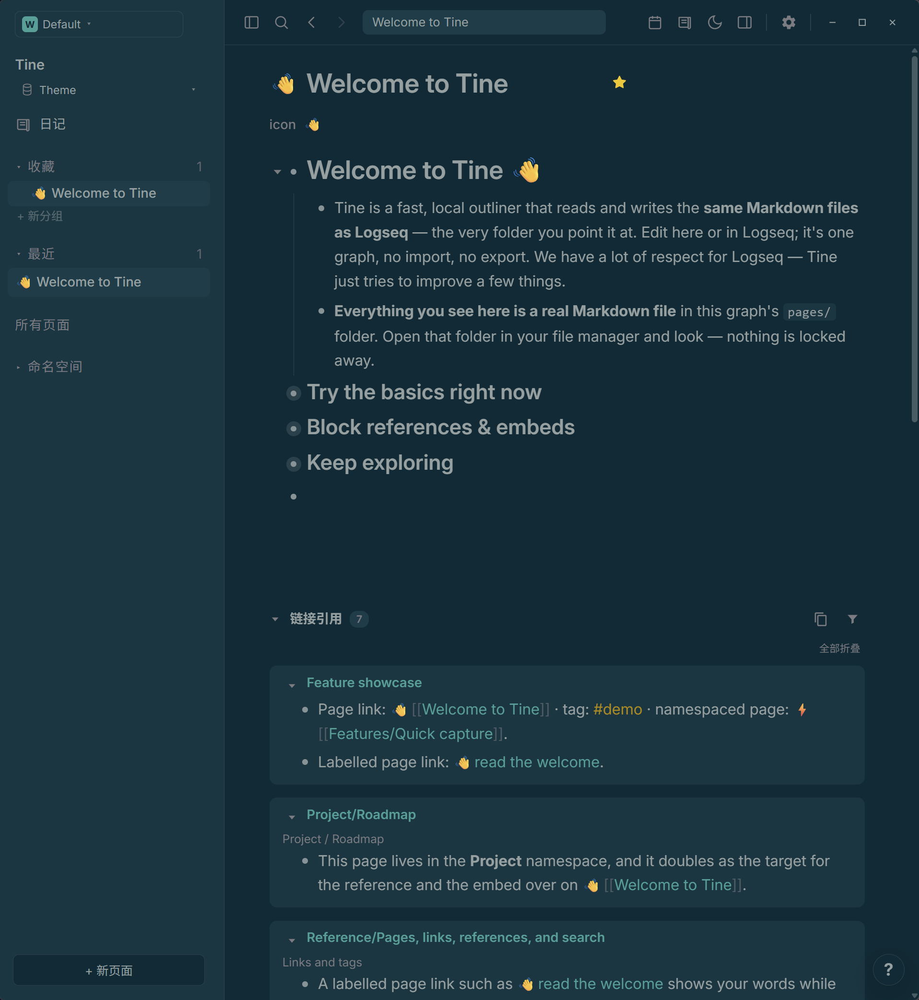
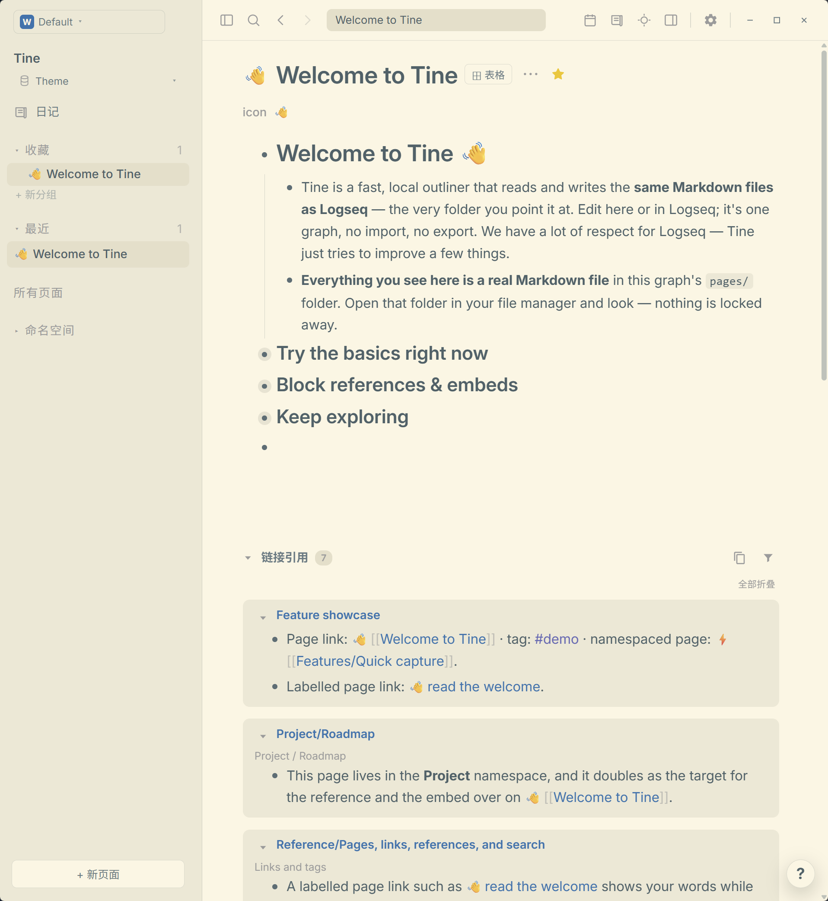

# Solarized · Prism

**蓝绿暮色轻覆静静的纸页；明暗流转之间，色彩仍保持从容的节律。**

[English](README.md) · [下载 theme.json](https://github.com/EllisMorrow/tine-theme-solarized-prism/releases/latest/download/theme.json)

Solarized 将原生浅色与深色并置：温润象牙白与深蓝绿相映，再以克制的蓝、青、黄、紫平衡全页。

### 深色模式

### 浅色模式

*用户测试后提供的 Windows 实机截图，两套配色均实际包含在同一个主题包中。*

## 安装

1. 下载 [theme.json](https://github.com/EllisMorrow/tine-theme-solarized-prism/releases/latest/download/theme.json)。
2. 在 Tine 打开 **设置 → 外观 → 主题包 → 选择 theme.json**，选择下载的文件。
3. 点击 **使用颜色**，选择 **浅色、深色或跟随系统**。

需要主题 API **0.2** 支持。原有 `logseq/custom.css` 和设备强调色可能影响效果；主题只负责 API 支持的颜色，不包含额外字体、布局或任务标记样式。

## 配色

| 角色 | 浅色 | 深色 |
| --- | --- | --- |
| 主背景 | `#fdf6e3` | `#002b36` |
| 侧栏 | `#eee8d5` | `#073642` |
| 正文 | `#4b6269` | `#839496` |
| 标题 | `#4b6269` | `#93a1a1` |
| 强调色 | `#268bd2` | `#2aa198` |
| 链接 | `#2074af` | `#2aa198` |
| 标签 | `#6468b5` | `#b58900` |
| 高亮底色 | `#eee8d5` | `#164653` |

## 验证情况

通过官方主题格式检查；浏览器样例检查了两套完整变量、模式切换及指定颜色组合。用户提供了上方 Windows 明暗实机截图，展示公开欢迎页面上的标题、正文、层级、链接、标签、行内代码和引用区域。高亮、选中操作、设置状态和其它平台未由这些截图覆盖，不据此宣称全部路径均已验证。

## 来源与边界

基于 [Solarized](https://github.com/altercation/solarized)，固定版本 `62f656a02f93c5190a8753159e34b385588d5ff3`，采用 MIT 许可并保留 [原始声明](LICENSE)。明暗两套均采用 Ethan Schoonover 的官方 Solarized 色板，并独立映射至 Tine 语义角色。LICENSE 保留上游 MIT 声明。

独立社区适配由 EllisMorrow 完成，使用 AI 辅助开发。不分发 Codex 程序代码、标志或附带资源，不代表相关项目或 OpenAI 的官方产品，也不承诺与 Codex 像素级一致。具体映射和验证边界见 [适配说明](docs/adaptation.md)。

顶部徽标统计 GitHub Release 附件累计下载量，不代表安装人数。可在本仓库反馈问题，附版本、系统、模式及不包含私人内容的截图。
